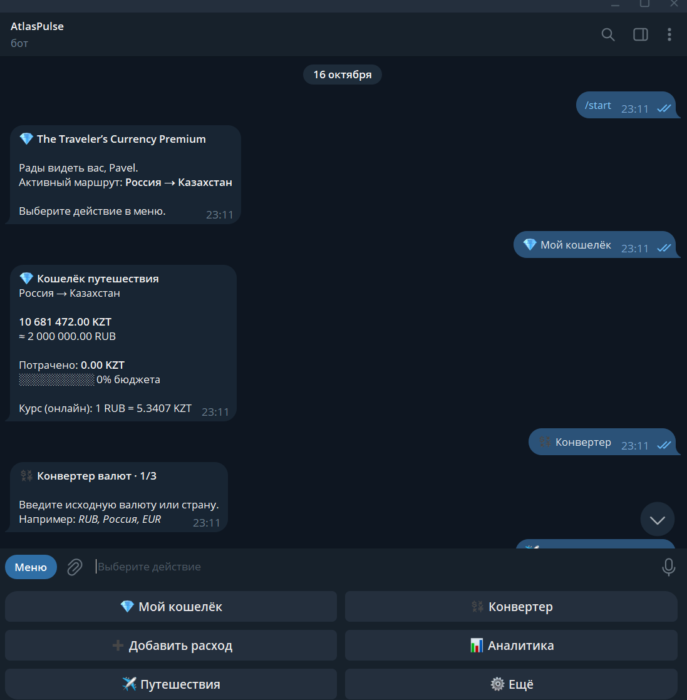
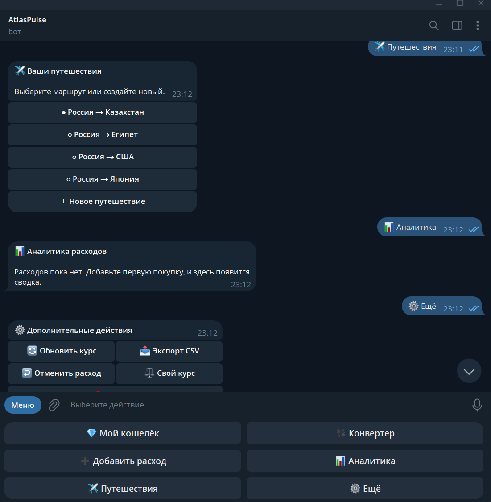

# The Traveler's Currency Premium v2.0.0

Профессиональная версия Telegram-бота «Валюта мира»: личный кошелёк
путешественника, быстрый конвертер, категории расходов и аналитика бюджета.

Публичное название бота — **AtlasPulse**.

## Возможности Premium

- премиальное главное меню без перегруженных slash-команд;
- несколько путешествий с быстрым переключением;
- кошелёк с остатком в домашней и местной валюте;
- прогресс расходования бюджета;
- независимый конвертер валют по стране или ISO-коду;
- расходы с шестью категориями и комментарием;
- аналитика по категориям и последние операции;
- отмена последнего расхода;
- обновление онлайн-курса и поддержка собственного курса;
- экспорт истории в CSV с UTF-8 для Excel;
- автоматическая миграция старой SQLite-базы без потери поездок;
- HTTPS для запросов к валютному API;
- секреты в `.env`, резервное копирование и systemd-запуск 24/7.

## Интерфейс AtlasPulse





## Локальный запуск в Windows

Откройте PowerShell в папке проекта:

```powershell
py -3.14 -m venv .venv
.\.venv\Scripts\Activate.ps1
python -m pip install --upgrade pip
pip install -r requirements.txt
Copy-Item .env.example .env
notepad .env
python bot.py
```

Заполните в `.env` значения `TELEGRAM_BOT_TOKEN` и
`EXCHANGE_RATE_ACCESS_KEY`. Существующий файл `traveler_wallet.sqlite3`
можно положить рядом с `bot.py`; при первом запуске он будет обновлён
автоматически.

## Проверка

```powershell
python -m unittest discover -s tests -v
python -m compileall -q .
```

## Обновление сервера

Скопируйте папку проекта на сервер, например в `/root/premium-update`, затем:

```bash
chmod +x /root/premium-update/deploy/update.sh
bash /root/premium-update/deploy/update.sh /root/currency_bot currency-bot.service
```

Скрипт перед изменениями создаёт резервную копию в
`/root/currency-bot-backups/<дата>`, сохраняет SQLite-базу, переносит значения
из старого `config.py` в закрытый `.env`, устанавливает зависимости и
перезапускает `currency-bot.service`.

Проверка после установки:

```bash
systemctl is-active currency-bot.service
journalctl -u currency-bot.service -n 80 --no-pager
```

## Структура

- `bot.py` — сценарии Telegram и пользовательские состояния;
- `database.py` — SQLite, миграции, статистика и отмена расходов;
- `current_api.py` — безопасный клиент валютного API;
- `country_currency.py` — страны, территории и валюты ISO/CLDR;
- `keyboards.py` — премиальное меню и inline-кнопки;
- `formatters.py` — суммы, курсы и индикатор бюджета;
- `exporter.py` — выгрузка истории в CSV;
- `deploy/` — systemd unit и установщик обновления;
- `tests/` — проверки миграции, учёта расходов и справочника валют.

